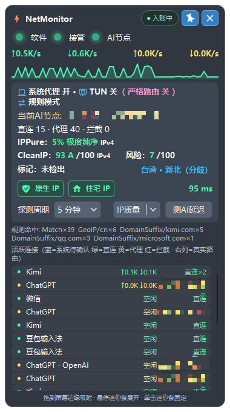

# NetMonitor

Windows桌面网络监控工具：查看实时流量、进程与目标服务、代理分流、实际AI出口、延迟及IP质量。支持已适配的 **Clash Verge Rev** 和 **FlClash**；NetMonitor不提供代理服务或订阅。

## 界面

展示图由用户提供，节点名称已遮挡。图中“入账中”为用户自行开启后的示例；首次启动默认为“已暂停”。节点、地区、分数和软件名称为当时示例，不是默认配置、代理推荐或可保证的检测结果。

## 最省事的安装方法

把下面一句话交给能操作你Windows电脑的AI：

> 请按本仓库对应正式Release的[AI安装指南](docs/AI_INSTALL.md)，下载安装NetMonitor，完成我现有Clash Verge Rev或FlClash的必要关联配置。默认使用非系统盘、关闭NetMonitor自启动、首次关闭历史流量入账；不要询问是否开启这两项。保留我的订阅、分流规则和个人数据，结束后告诉我实际完成了什么。

仓库：[313733807GG/netmonitor-pro](https://github.com/313733807GG/netmonitor-pro)。下载入口：[正式Release](https://github.com/313733807GG/netmonitor-pro/releases/latest)。以该Release的`release-manifest.json`和校验文件为准，不下载第三方改包。

程序包完整解压即可使用，不需要安装Python、Node或浏览器自动化组件。需要正常Windows管理员授权才能启用ETW精准采集。

## 默认体验

- 首次安装选可写的非系统固定盘，通常为`D:\Apps\NetMonitor`；没有合适磁盘时由AI说明并协助选择。
- NetMonitor自启动关闭，不创建定时任务。
- 首次历史流量入账关闭；实时监控和已有名称识别继续工作。
- 不后台启动Edge，不批量测速节点，不替换你的普通代理选择。
- 用户需要历史记录时再自行开启入账；升级保留已明确选择的入账状态。

## 文档

- [AI自动安装](docs/AI_INSTALL.md)：下载、校验、配置、验收及交付。
- [安装、升级与卸载](docs/INSTALLATION.md)。
- [两款代理软件的必要配置](docs/PROXY_SETUP.md)。
- [界面、连接名称与账本](docs/USAGE.md)。
- [后续维护和故障排查](docs/MAINTENANCE.md)。

IP评分依赖外部站点与当前线路；限流、验证和未就绪会明确提示。IPPure轻量接口未覆盖的地址不显示伪造分数，IPv6无系数不等于0%风险。未知进程/服务并不自动意味着恶意，工具也不保证识别所有目标。

实际兼容版本、许可证和签名状态见对应Release说明。未经该Release实测的客户端版本，不应仅因“使用Mihomo”就宣称完全兼容。
