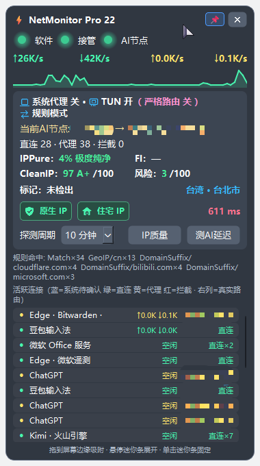

# NetMonitor Pro 22.0.1

Windows 桌面网络监控小组件：系统/进程实时流量、Mihomo 连接分流、AI 出口节点、HTTP 延迟与 IP 质量。

> **本版本已在 Clash Verge Rev / Mihomo v1.19.32 和 FlClash 0.9.2 / Mihomo v1.19.33 实机验证。其他 Mihomo 客户端可能适用但需自行适配；非 Mihomo 内核不建议下载使用。** 本项目不是 Clash Verge 官方产品，不附带代理服务、订阅或节点。

[下载 v22.0.1](https://github.com/313733807GG/netmonitor-pro/releases/tag/v22.0.1) · [详细安装](docs/INSTALLATION.md) · [日常使用](docs/USAGE.md) · [后期维护](docs/MAINTENANCE.md) · [交给 AI 安装](docs/AI_INSTALL.md) · [IP 检测入口](docs/CLASH_VERGE_SETUP.md) · [更新记录](CHANGELOG.md)

本版新增 FlClash 基础适配及同 IP 缓存印证、CleanIP 风险命中明细、亮蓝主题和多屏吸附修复。详见[新版变化](docs/V22_CHANGES.md)与[FlClash 设置](docs/FLCLASH_SETUP.md)。

## 界面



展示图由维护者提供，代理商名称已遮挡。节点、地区、分数和软件名称为当时示例，不是默认配置、代理推荐或可保证的检测结果。

## 下载运行

1. 下载 Release 中的 **NetMonitor-v22.0.1-windows-x64.zip**，核对同页 `SHA256SUMS.txt`；GitHub 自动生成的 Source code 是源码，不含可运行 EXE。
2. 完整解压到有写入权限的独立目录，保留 `NetMonitor.exe` 和整个 `_internal`，不要只复制 EXE。便携包无需另装 Python。
3. 启动 Clash Verge Rev 或 FlClash，再启动 `NetMonitor.exe`，按 Windows 提示允许管理员权限，以启用 ETW 精准采集。普通权限下功能可能降级。
4. 如需 IPPure/CleanIP 评分，先按[检测入口说明](docs/CLASH_VERGE_SETUP.md)合并专用配置；缺少此入口时评分不可用，普通流量监控仍可使用。

已在 Windows x64、Python 3.12.10 构建环境、Clash Verge Rev 2.5.x / Mihomo v1.19.32 验证；FlClash 0.9.2 / Mihomo v1.19.33 也已实测；没有对所有 Windows 版本、其他客户端或架构作兼容保证。运行系统需能加载随包 Python/Qt 运行库。

**EXE 未做发布者代码签名**，Windows 智能应用控制可能阻止 EXE 或依赖 DLL。哈希校验不等于代码签名。请保留系统安全保护，遇到拦截按[使用说明](docs/USAGE.md)排查；不要反复重新打包或关闭保护来碰运气。

## 主要功能

- 系统网卡与 ETW 进程流量，覆盖 TCP、UDP/QUIC；代理分流/系统连接视图，连接悬停取证、点击固定列表、吸附迷你条。
- 显示系统代理、TUN、严格路由、规则/全局/直连模式；无法取得可信状态时显示未知。
- 识别 AI 实际出口，规则模式优先 ChatGPT/OpenAI，其次 Claude/Gemini；全局模式使用 GLOBAL 叶子节点。多出口场景只展示选定的 AI 出口。
- IPPure 系数、CleanIP 纯净度/等级、风险分、风险标记、IP 类型和地区；每次启动按“订阅标识 + 节点名”缓存，手动“IP质量”可刷新。
- “探测周期”和“测AI延迟”测量节点访问 ChatGPT 测试地址的 HTTP 耗时，独立于 IP 质量缓存；不代表 ICMP 延迟或完整 AI 服务可用性。
- 原流量账本与待鉴定目标保存在本机，域名/其他名称、裸 IP、乱码异常分别保留配额。

## 需要自行维护的内容

**未知名称不会自动在线鉴定或自动更新别名库。** `src/connection_labels.py` 是本地静态识别库；进程名、父进程和域名只是归属线索，不保证所有连接都能识别，也不能仅凭随机域名/动态 IP 判断应用或安全性。待鉴定日志需使用者定期审阅、核实归属并更新源码/重新构建；详见[维护流程](docs/USAGE.md#未知名称维护)。

检测网站是独立第三方服务，可能限流、要求人机验证、改接口或停止服务；评分、类型和地理库会有差异，不能当作账号风控保证。软件不绕过验证，不因接口失败伪造评分。动态出口变化但节点名未变时，缓存需手动刷新。

日志、流量账本、导出文件可能含域名、IP、程序路径和节点名；**不要原样上传到公开 Issue 或交给在线 AI**。仓库和便携包不包含维护者的日志、账本、订阅、密钥或个人代理脚本。

## 从源码运行与构建

使用 Windows x64、受信任的独立 Python 3.12，创建自己的虚拟环境：

```powershell
py -3.12 -m venv .venv
.\.venv\Scripts\python.exe -m pip install -r requirements.txt
.\.venv\Scripts\python.exe -I tools/project_cli.py check
.\.venv\Scripts\python.exe -I tools/project_cli.py test
.\.venv\Scripts\python.exe -I tools/project_cli.py run
```

构建另装 `requirements-build.txt`，执行：

```powershell
.\.venv\Scripts\python.exe -m pip install -r requirements-build.txt
.\.venv\Scripts\python.exe -I tools/project_cli.py build
```

输出 `dist/NetMonitor`，构建不自动安装或重启程序。源码版与 EXE 不要同时采集同一个 ETW 会话。当前 192 项回归测试；GitHub Actions 在 Windows 上运行。`src/etw` 随附 pywintrace 0.3.0 源码，**不要安装 PyPI 上同名的 `etw` 包**。

## 许可

项目自有源码为 [MIT](LICENSE)。pywintrace、Python、Qt/PySide6 等保留各自许可，见 [第三方说明](THIRD_PARTY_NOTICES.md) 与 `THIRD_PARTY_LICENSES/`；MIT 不覆盖第三方组件。
